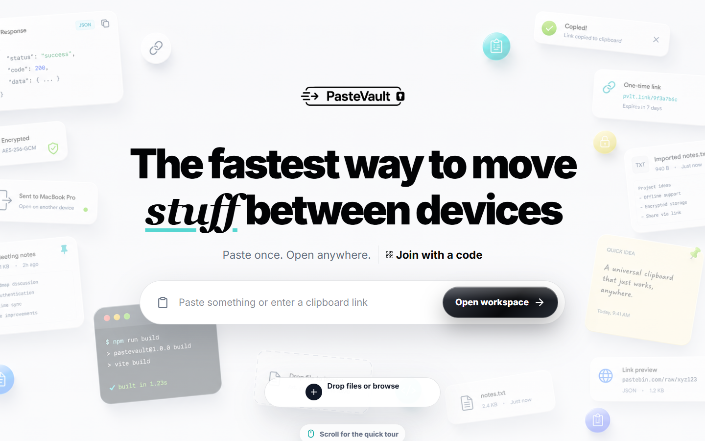
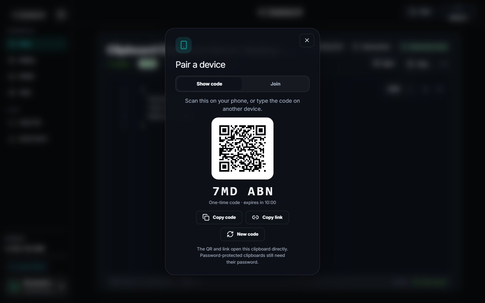
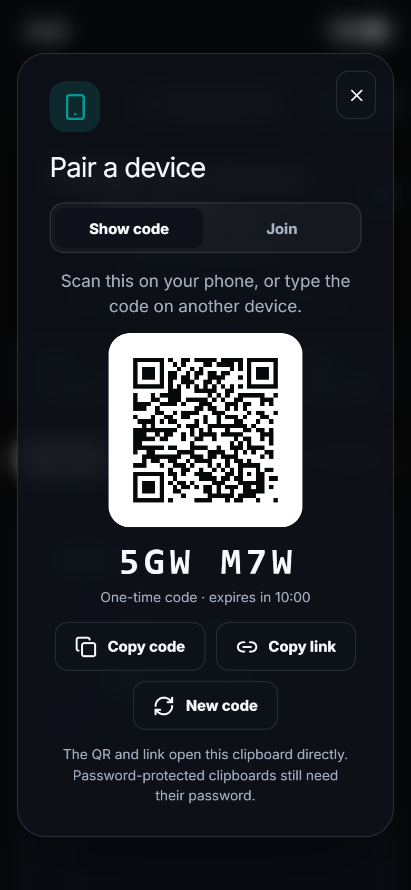

# PasteVault — stop texting yourself links

Paste once, open anywhere. A private clipboard for text, code, links and JSON that moves between your devices, encrypted before it leaves the browser.



No account. Your clipboard is a link. Lock it with a password and even the server only ever sees ciphertext.

**[Open PasteVault →](https://pastevault-lime.vercel.app)** · React · Vite · Web Crypto · Upstash Redis

---

## What it does

- **One link, one clipboard.** The first paste creates it; clips stay until you delete them
- **Pair a device in seconds.** Show a QR code and a one-time 6-character code, then scan or type it on the other device
- **Near-realtime sync.** Changes appear on your other devices within seconds, and instantly when you switch back to the tab
- **Encrypted files and images.** Paste, attach or drop a file (up to 5 MB, kept 7 days). It is encrypted on your device before upload, and previews decrypt locally: images, video, audio, PDF, and text/code with auto-detected language and a formatted view
- **Copy in one tap**, read straight from the system clipboard, share a single clip by link
- **Import and export** text/code files and full JSON history, with per-file validation
- **Installable** as a PWA

<p>
  
  
</p>

## Pairing

Open **Options → Pair device** on any clipboard.

- The **QR code** is generated in the browser (no external service) and opens the clipboard directly.
- The **6-character code** is single use and expires after 10 minutes. It uses an alphabet without look-alike characters (no `0/O`, `1/I/L`) and the lookup endpoint is rate limited.
- On the other device choose **Join with a code** on the landing page, then type the code or tap **Scan QR**. Scanning uses the native `BarcodeDetector` where it exists and falls back to a lazy-loaded `jsQR` decoder in browsers without it. If the camera is blocked you can always type the code.

A code only hands out the clipboard link, which is already the secret for an unlocked clipboard. A password-protected clipboard still asks for its password on the new device.

## How the encryption works

Encryption happens in the browser with **AES-256-GCM**, before anything is synced.

- **Unlocked clipboards** are encrypted for sync with a key derived from the clipboard link id, so only someone with the link can read them.
- **Password-protected clipboards** derive the key from your password with **PBKDF2 (210,000 iterations)** and stay encrypted on the device too. The password never leaves the device.
- **Sync** stores the encrypted blob in Upstash Redis / Vercel KV. The API rejects anything that isn't an encrypted payload, and caps requests at 1 MB.

The server can route your data but can't read it.

## How sync works

Each device polls for changes every 3 seconds while the tab is visible (backing off to 10 seconds when idle) and refreshes immediately on focus or reconnect. Polls send the version the device already has, and the API answers `304 Not Modified` so unchanged ciphertext is never re-downloaded. Conflicting edits are detected by content version and never overwrite a newer remote save silently.

`GET /api/health` reports whether hosted storage is reachable (`ok`, `not-configured`, `unauthorized`, `unreachable`, `timeout`) without exposing any connection details, and the real storage error is logged server-side.

## Run it

```bash
npm install
npm start          # http://localhost:4000
npm test
```

The dev server also serves the `/api` functions, using an in-memory store when no Redis is configured, so sync and pairing work locally without any setup.

For cross-device sync in production, set `UPSTASH_REDIS_REST_URL` + `UPSTASH_REDIS_REST_TOKEN` (or `KV_REST_API_URL` + `KV_REST_API_TOKEN`). Without them the app runs fully local and production writes return `503` rather than pretending to sync.

## Checks

```bash
npm run verify           # lint, build, smoke, store and API checks
npm run functional:check # browser checks, need `npm start` running
npm run pair:check       # QR, one-time code and camera flow
npm run qr:check         # generated QR codes decode with the jsQR fallback
npm run sync:check
npm run mobile:check
npm run visual:check
```

## Built with

React, Vite, Tailwind CSS, Web Crypto API, Vercel Functions, Upstash Redis, qrcode-generator, jsQR.

See [CHANGELOG.md](CHANGELOG.md) for what changed in each version.

MIT © [Kingsley Aremu](https://github.com/iice257)
